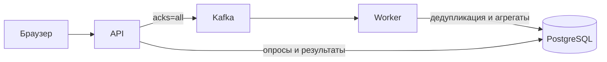

# VOTING

Анонимные опросы с одним вопросом и одним или несколькими вариантами ответа. Админка позволяет создавать опросы и смотреть обезличенные результаты.

## Запуск

Нужны Docker и Docker Compose v2.

```sh
git clone https://github.com/LimeOnTop/VOTING.git
cd VOTING
./scripts/init-env.sh
docker compose up --build -d
curl http://localhost:8080/readyz
```

Откройте <http://localhost:8080/admin> и введите `ADMIN_TOKEN` из `.env`. Создайте опрос и перейдите по его ссылке `/p/<id>`. Для отдельного участника используйте другой браузер или приватное окно.

После отправки страница подтверждает приём ответа в очередь. Подсчёт выполняется асинхронно; результаты в админке обновляются каждые 3 секунды. У опубликованного опроса нельзя изменить варианты и время проведения.

Остановка: `docker compose down`. Удаление локальных данных: `docker compose down -v`.

## Устройство



API подавляет повторы в памяти, отправляет голос в Kafka и возвращает `202` после подтверждения записи. Worker пакетно обновляет результаты; уникальный ключ участника и счётчики фиксируются одной транзакцией. После рестарта API повтор может попасть в очередь, но не увеличит итог дважды.

Cookie идентифицирует браузер, а не человека: её очистка позволяет проголосовать заново. Receipt подтверждает приём, не завершение подсчёта. Результаты согласуются асинхронно.

Слои приложения, обработка голосов и кеширование описаны в [архитектуре](docs/architecture.md).

## Проверки

Для запуска на хосте нужны Go 1.27.3, Node.js 22, golangci-lint 2.15 и Helm 3.18.

```sh
make check

# Интеграционные тесты с PostgreSQL из Compose
make integration

# Проверки API, дедупликации и восстановления
set -a; . ./.env; set +a
python3 scripts/smoke.py
python3 scripts/recovery.py
```

Интеграционные тесты создают и удаляют отдельные схемы. Без `TEST_DATABASE_URL` они пропускаются; CI запускает их на тестовой БД. `recovery.py` перезапускает локальные API и worker.

Нагрузочная проверка при открытом опросе:

```sh
k6 run -e POLL_ID=<id> -e RATE=100 -e DURATION=30s scripts/load.js
```

Каждая итерация использует новую cookie. Сценарий измеряет приём запросов, не скорость подсчёта.

## Развёртывание и API

HTTP API использует префикс `/api/v1`.

- [Настройка окружения и Kubernetes / Helm](docs/operations.md).
- [Маршруты и форматы ответов](docs/api.md).
- [Swagger 2.0](api/swagger.yml) для Swagger UI/Editor.

Метрики API: <http://localhost:9090/metrics>. Локальный Prometheus запускается командой `docker compose --profile observability up -d prometheus` и доступен на <http://localhost:9091>.

CI проверяет Go, frontend, зависимости, Helm и Compose smoke/recovery. Workflow `Publish image` публикует образ в GHCR с тегом commit SHA. Развёртывание выполняется отдельно.

Документация генерируется из Swagger-аннотаций обработчиков командой `make swagger`.
