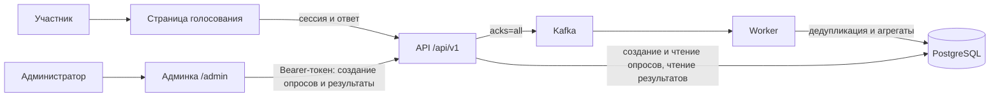

# VOTING

Анонимные опросы с одним вопросом и одним или несколькими вариантами ответа. Админка позволяет создавать опросы и смотреть обезличенные результаты.

## Запуск

Нужны Docker, Docker Compose v2, Make и OpenSSL.

```sh
git clone https://github.com/LimeOnTop/VOTING.git
cd VOTING
make init
docker compose up --build -d
curl http://localhost:8080/readyz
```

Откройте <http://localhost:8080/admin> и введите `ADMIN_TOKEN` из `.env`. Создайте опрос и перейдите по его ссылке `/p/<id>`. Для отдельного участника используйте другой браузер или приватное окно.

После отправки страница подтверждает приём ответа в очередь. Подсчёт выполняется асинхронно; результаты в админке обновляются каждые 3 секунды. У опубликованного опроса нельзя изменить варианты и время проведения.

Остановка: `docker compose down`. Удаление локальных данных: `docker compose down -v`.

## Устройство



API подавляет повторы в памяти, отправляет голос в Kafka и возвращает `202` после подтверждения записи. Worker пакетно обновляет результаты; уникальный ключ участника и счётчики фиксируются одной транзакцией. После рестарта API повтор может попасть в очередь, но не увеличит итог дважды.

Админка использует защищённые маршруты `/api/v1/admin/*`: создание опросов и чтение агрегированных результатов. Доступ требует `ADMIN_TOKEN`; участникам эти операции недоступны.

Cookie идентифицирует браузер, а не человека: её очистка позволяет проголосовать заново. Receipt подтверждает приём, не завершение подсчёта. Результаты согласуются асинхронно.

Слои приложения, обработка голосов и кеширование описаны в [архитектуре](docs/architecture.md).

## Развёртывание и API

HTTP API использует префикс `/api/v1`.

- [Настройка окружения и Kubernetes / Helm](docs/operations.md).
- [Маршруты и форматы ответов](docs/api.md).
- [Swagger 2.0](api/swagger.yml) для Swagger UI/Editor.

Метрики API: <http://localhost:9090/metrics>. Локальный Prometheus запускается командой `docker compose --profile observability up -d prometheus` и доступен на <http://localhost:9091>.

Workflow `Publish image` публикует образ в GHCR с тегом commit SHA. Развёртывание выполняется отдельно.

Документация генерируется из Swagger-аннотаций обработчиков командой `make swagger`.
