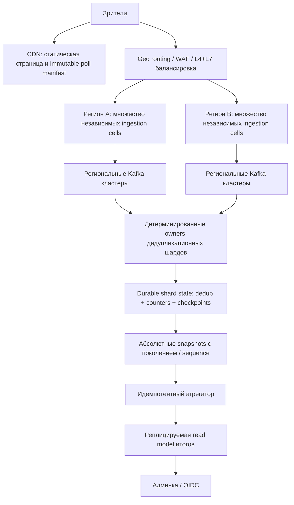

# Архитектура и пределы масштабирования

## Требование и допущения

Для проектирования принято уточнение заказчика: 100 000 000 **запросов голосования/с**, в течение 60 с. Это 6 млрд запросов; число уникальных участников может быть меньше. Исходная формулировка «100 млн за минуту» означала бы ~1,67 млн RPS, но здесь используется более жёсткая постановка. Регистрации нет. Типы — один вариант (A/B включительно) и несколько вариантов. Приём — полуинтервал `[opens_at, closes_at)` по серверному времени UTC. Первый бюллетень браузера побеждает. Итоги могут отставать, но принятый голос нельзя молча отбросить.

## Реализованная система

Один Go binary, три режима `api`, `worker`, `migrate`. API обслуживает React bundle, публичные и административные маршруты. Worker отдельно масштабируется в consumer group. 12 Kafka partitions в локальном окружении. PostgreSQL хранит metadata, журнал учтённых бюллетеней и 256 бакетов счётчиков.

Приём: signed cookie → валидация окна/вариантов → событие v1 → Kafka с `acks=all` → 202. Cookie выдаётся отдельным `GET /api/session` с `no-store`; endpoint голосования требует существующую cookie. Повторное нажатие не порождает новую идентичность. HMAC различается по опросам. Токен браузера не публикуется в Kafka. Kafka key: `poll_id:voter_key`, распределяющий один горячий опрос по партициям.

Подсчёт: fetch → проверка формата и исходного окна по `accepted_at` → SQL transaction (`INSERT ... ON CONFLICT DO NOTHING`, increment counters) → commit → offset commit. Повторная доставка безопасна. Одновременные дубликаты сериализуются уникальным индексом. Ошибка в середине SQL откатывает и бюллетень, и счётчики. Варианты сортируются перед захватом блокировок. Результаты читаются в repeatable-read snapshot.

Worker намеренно простой: один fetch/transaction/offset commit за итерацию. Его throughput ограничен сетевыми round trips. Этот путь доказывает корректность, **не обеспечивает production скорость**. Нужны batch processing, независимые физические шарды и измерения. В локальной схеме metadata lookup также SQL на каждый обрабатываемый event. Он должен быть заменён bounded immutable cache в масштабной реализации.

## Что нужно для 100 млн RPS

Это целевая схема, **не реализованные скрытые возможности Helm chart**. Ingestion cells отделяют отказ/перегрузку одного пула от остальных. В каждом регионе независимые очереди и лимиты. Число кластеров, партиций и узлов определяется benchmark и доступными сетями, а не фиксируется произвольно в YAML.

### Многорегиональная дедупликация

Нельзя независимо учитывать один `voter_key` в каждом регионе: повтор после Geo failover удвоит голос. Регион приёма может меняться, но authoritative owner состояния выбирается стабильным маршрутом `hash(poll_id,voter_key)`. Все события этого ключа проходят через одного owner. Failover owner требует fencing/epoch и согласованного восстановления; если единственный безопасный owner недоступен, события сохраняются в региональном журнале, а подсчёт задерживается. Доступность приёма и мгновенная доступность точного результата — разные гарантии.

Подсчёт должен атомарно сохранять dedup set, counter и checkpoint. Варианты: Kafka Streams с local state/changelog и транзакциями Kafka для offsets/output либо физически шардированное транзакционное хранилище. Последнее проще по модели текущего кода, но потребует маршрутизации и ограничения нагрузки на каждый шард. PostgreSQL одного инстанса для цели не подходит.

Доставка snapshots агрегатору тоже повторяется. Передаются **абсолютные значения** `(poll, shard, epoch, sequence, counters)`; старые/повторные версии игнорируются. Нельзя повторно суммировать инкрементальные дельты без дедупликации. Итог финализируется по закрытию intake и checkpoint/watermark всех шардов, а не только по часам.

### Ёмкость

100 байт/событие дают 10 ГБ/с и 600 ГБ за минуту только payload. JSON текущей реализации больше 100 байт; HTTP headers, TLS, Kafka framing и служебные запросы сюда не входят. Репликация x3 делает нижнюю оценку порядка 30 ГБ/с записываемого payload по копиям, без WAL/index и cross-region overhead. 6 млрд уникальных 32-байтовых hashes — уже 192 ГБ только ключей дедупликации; структурные накладные расходы значительно больше.

Чтение manifest, session bootstrap и receipt добавляют запросы сверх 100 млн vote RPS. На целевом масштабе персональные session/receipt нельзя раздавать через общий SQL. Статический bundle и manifest — CDN; signed token выдаётся edge/service без БД, с ограничениями против массовой выдачи; статусы — shard read model/cache с backoff, jitter и прекращением polling после учёта. Публичные ответы с Set-Cookie никогда не кешируются CDN.

Kubernetes HPA не успеет создать мощности за телевизионную минуту. Нужны предварительное расписание capacity, прогрев соединений/metadata, запас узлов и проверка квот провайдера. Необходимо измерить RPS на pod, число соединений, TLS throughput, Kafka produce p99, ingress bandwidth, lag, уникальные голоса/с и recovery time. **Точных capacity и бюджета нет: нагрузочные данные и инфраструктура отсутствуют.**

## Ошибки и гарантии

- Нет Kafka quorum: 503, а не ложное подтверждение. После timeout запись могла успеть сохраниться; клиент повторяет с тем же cookie, SQL устраняет дубль.
- Worker недоступен: 202 возможен, backlog растёт. После восстановления очередь дочитывается.
- БД недоступна: worker не коммитит offset, повторяет transaction. API readiness становится false (в этой реализации metadata/receipt/admin зависят от БД).
- Некорректное событие в topic: worker останавливается без продвижения offset. Это сознательный fail-closed выбор. Нужны alert, расследование и управляемое исправление/карантин, а не молчаливый skip.
- Topic retention истёк до обработки: Kafka может удалить ещё не учтённые события. Для production retention должен покрывать худшее время простоя, а lag age/диск — мониториться заранее. Локально retention 24 часа.
- Потеря Kafka данных/SQL диска за пределами гарантий репликации не решается идемпотентностью. Нужны RF≥3, min ISR≥2, запрет unclean leader election, PostgreSQL HA/PITR и проверенные восстановления.
- Смена signing key меняет идентичность участников; во время активного опроса ключ не ротируется. Для production нужна версия ключа и overlap keyring.

## Безопасность и приватность

UI не хранит admin token в localStorage; он живёт в памяти до перезагрузки. Bearer authentication не использует admin cookie, поэтому не создаёт ambient CSRF-доступ к admin API. Для браузерных mutations проверяются Origin/Fetch Metadata. CSP, запрет framing, ограничение тела 8 KiB, 1024 in-flight publications/pod, таймауты и bounded metadata cache реализованы. TLS/SASL Kafka поддерживаются через env; plaintext в Compose только для localhost/dev. Не логируются Cookie, Authorization, IP или payload голоса.

Cookie — псевдоним браузера, не личность. HMAC — псевдонимизация, не абсолютная анонимность: обладатель ключа и cookie может связать их. Админ получает только агрегаты; отдельного API выгрузки бюллетеней нет. Production retention сырых events/псевдонимов, доступ операторов, geo requirements и сроки удаления должны быть согласованы. Автоматическое удаление данных не реализовано.

## Источники решений

- [Kafka delivery semantics и транзакции](https://kafka.apache.org/40/design/design/): exactly-once имеет границы; SQL effect обеспечивается уникальностью и transaction, а не настройкой producer.
- [Kubernetes probes](https://kubernetes.io/docs/tasks/configure-pod-container/configure-liveness-readiness-startup-probes/): liveness не зависит от внешней БД, readiness управляет маршрутизацией.
- [Horizontal Pod Autoscaling](https://kubernetes.io/docs/concepts/workloads/autoscaling/horizontal-pod-autoscale/): HPA реагирует на метрики; предварительная capacity необходима для короткого пика.
- [Helm best practices](https://docs.helm.sh/docs/chart_best_practices/): конфигурация окружения через values, секреты отдельно.
